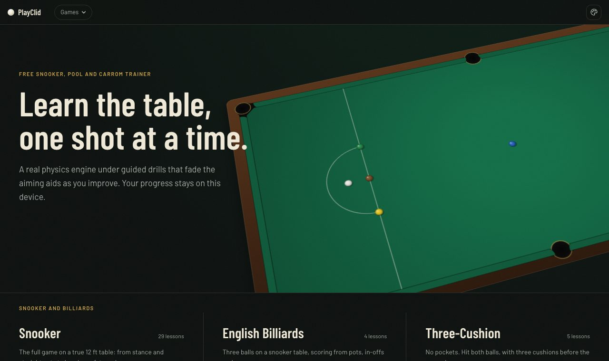
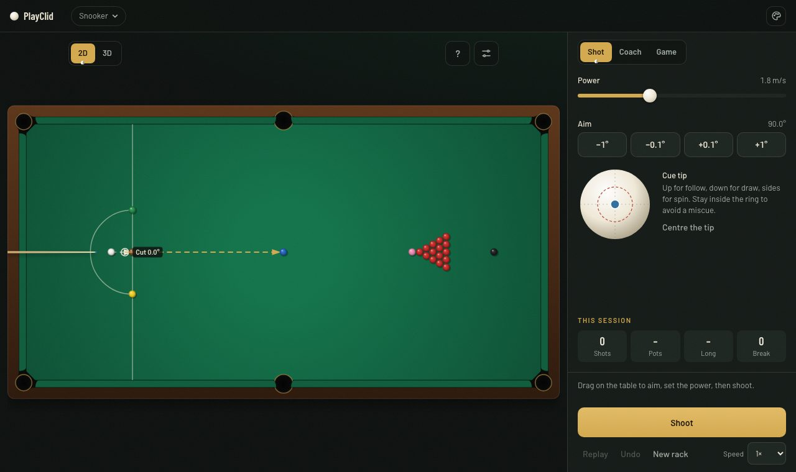

# PlayClid

**Learn snooker, pool, carrom and five more table games on a real physics engine, free in your browser.**

PlayClid is a practice table and a coach. Line up a shot and see exactly where every ball will go, then work through guided drills that fade the aiming aids as you improve. There is no backend and no account: everything runs in the browser, works offline once loaded, and progress stays on the device.

[](https://github.com/agnyaatha/sim-pool/actions/workflows/ci.yml)
[](LICENSE)





## What's in it

| Family | Games |
|---|---|
| Snooker and billiards | Snooker, English Billiards, Three-Cushion |
| Pool | 8-Ball Pool, 9-Ball |
| Disc and board games | Carrom, Crokinole, Shuffleboard |

- **A real physics engine.** Each shot is solved exactly, event by event: sliding, rolling and spin, throw and squirt, cushion rebounds (Mathavan's model), pocket jaws, and break-offs with 22 balls in a few milliseconds. The values come from published measurements, and [each game's physics page](docs/games/README.md) says how far each number can be trusted.
- **Lessons and drills.** More than 60 lessons, from stance and straight pots to breaks, safety and escapes. Aiming lines help at first and are taken away as you pass.
- **Challenges, a coach and a computer opponent.** Clear-the-table puzzles in a set number of shots, a coach that finds a shot for you, and full rules against a friend or the computer.
- **2D and 3D views** from the same simulation, so they can never disagree.
- **Installable and offline.** It works as a progressive web app on phones, tablets and computers.

## Quick start

You need [Node.js](https://nodejs.org) 20.9 or newer (22 is recommended; see [`.nvmrc`](.nvmrc)) and git.

```bash
git clone https://github.com/agnyaatha/sim-pool.git
cd sim-pool
npm install        # also turns on the pre-commit checks
npm run dev        # open http://localhost:3000
```

Before you send a change, run the same checks CI runs:

```bash
npm run check      # files, typecheck, lint, tests and a production build
```

The full setup, the project tour and the day-to-day workflow are in the **[developer guide](docs/development/getting-started.md)**.

## Contributing

Contributions are very welcome, from a typo fix to a new game. Good places to start:

- **Physics accuracy.** If something on the table does not behave like the real game, open an issue with what you expected. Video or published measurements help most.
- **Lessons and challenges** are plain data and a good first contribution. See [lessons and challenges](docs/architecture/lessons-and-challenges.md).
- **A new game**, following [adding a game](docs/architecture/adding-a-game.md).
- Issues labelled `good first issue`.

Please read [CONTRIBUTING.md](CONTRIBUTING.md) before opening a pull request, and follow the [code of conduct](CODE_OF_CONDUCT.md). Report security problems privately, as described in [SECURITY.md](SECURITY.md).

**Looking for maintainers.** If you would like to help look after the project (reviewing pull requests, triaging issues, or owning a game), open an issue titled "Maintainer interest" and say a little about yourself.

## Documentation

Everything is in [`docs/`](docs/README.md):

| Topic | Start here |
|---|---|
| Setting up and working on the code | [Developer guide](docs/development/getting-started.md) |
| How the code fits together | [Architecture overview](docs/architecture/overview.md) |
| How the physics works | [Physics engine](docs/physics/README.md) |
| Each game's rules and parameters | [Games](docs/games/README.md) |
| Adding a game | [Adding a game](docs/architecture/adding-a-game.md) |
| Checks run before each commit | [Pre-commit checks](docs/development/checks.md) |
| Deploying, search and link previews | [Deploying and search](docs/development/deploy-and-seo.md) |
| Usage analytics and consent | [Analytics](docs/development/analytics.md) |

## Tech

Next.js 16 (App Router), React 19, TypeScript, Tailwind CSS 4, three.js for the 3D view, and Vitest. The physics engine in `src/core/sim/` is plain TypeScript with no dependencies.

## License

[MIT](LICENSE). You may use, change and share the code, including commercially, as long as the copyright notice stays with it.
